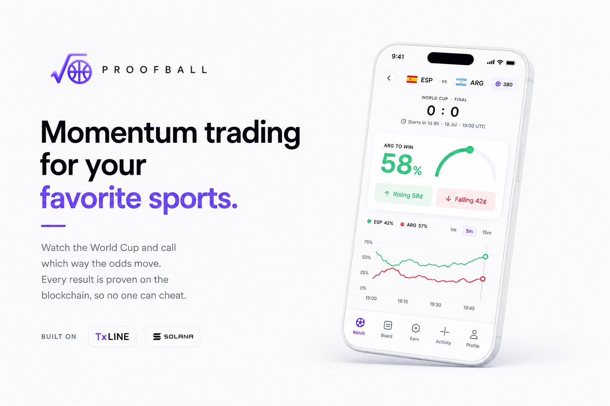
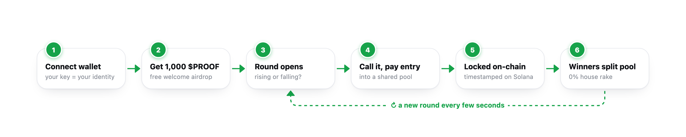
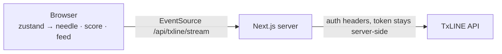
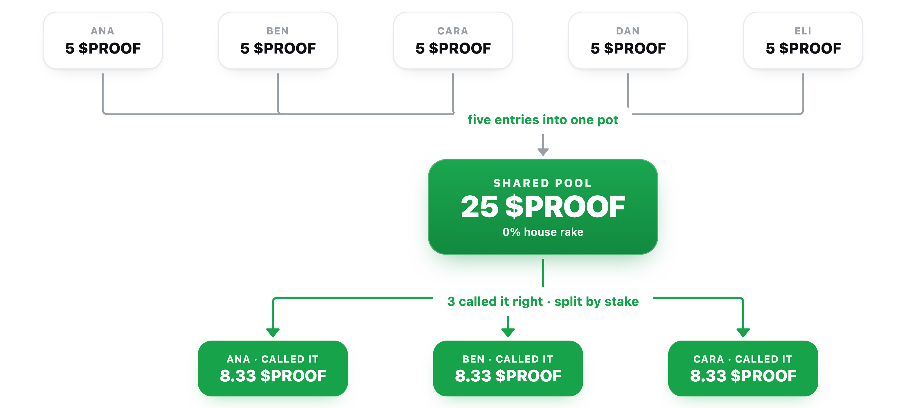

<p align="center">
  
</p>

<h1 align="center">ProofBall</h1>

<p align="center">
  <strong>Momentum trading for your favorite sports.</strong><br />
  Call the live win-probability of a match; every result is settled against on-chain-anchored data,
  so the house can't cheat. Free to play. Built on <strong>TxLINE (TxOdds)</strong> and <strong>Solana</strong>.
</p>

<p align="center">
  <a href="https://proofball.xyz"><strong>Play it live at proofball.xyz</strong></a> ·
  <a href="https://proofball.xyz/how-it-works">How it works</a> ·
  <a href="docs/WHITEPAPER.md">Whitepaper</a> ·
  <a href="#quickstart">Quickstart</a>
</p>

<p align="center">
  
  
  
  
</p>

<a href="https://proofball.xyz">
  
</a>

The app is wired to the **real TxLINE World Cup feed**. The featured match is the
**Spain vs Argentina final**, and the lobby links to **all 30 finished knockout matches** with their
real scores — each one playable as an honest replay simulation.

## Features

- **Live win-probability needle** — the de-margined 1X2 "StablePrice" from TxLINE, streamed to the browser over SSE.
- **Call the momentum** — predict which way the needle swings; calls are pooled **parimutuel**, and each one is committed on-chain (Solana memo) as a provably-fair anchor.
- **$PROOF token economy** — a real devnet SPL token; fresh wallets are airdropped 1,000 $PROOF to play immediately, with an auditable airdrop ledger.
- **30 real finished matches** — the full knockout bracket with real scores and event timelines, replayable at `?speed=` 1/2/5/10×.
- **Global leaderboard** — Redis-backed, shared across all players, restored on sign-in; your calls persist per wallet with the match minute they were made.
- **Wallet sign-in, desktop and mobile** — Phantom / Solflare / Backpack via Wallet Standard, plus Mobile Wallet Adapter on Android and deeplinks on iOS.
- **Shareable moments** — OG earnings cards (`/api/og`) and `/call` unfurl permalinks for posting wins.
- **Feels alive** — zero-asset Web Audio sound engine (with mute), framer-motion micro-interactions, light and dark themes.

## The tournament (all real TxLINE data)

The whole knockout bracket is served: **30 finished matches** (Round of 32 → Round of 16 →
Quarter-finals → Semi-finals), each with its real scoreline. Browse them on
[`/results`](https://proofball.xyz/results) (grouped by round); the lobby shows the latest few plus a
"See all 30 previous matches" link.

| Round | Match | Result |
| --- | --- | :---: |
| Semi-final | 🇫🇷 France vs 🇪🇸 Spain | 0 : 2 |
| Semi-final | 🏴󠁧󠁢󠁥󠁮󠁧󠁿 England vs 🇦🇷 Argentina | 1 : 2 |
| Quarter-final | 🇦🇷 Argentina vs 🇨🇭 Switzerland | 3 : 1 |
| **Final** | 🇪🇸 **Spain vs Argentina** 🇦🇷 | Sun 19 Jul 2026, 19:00 UTC |

- **Open the Final** to see the live win-probability and make a real call.
- **Open a finished match** to replay its real event timeline (goals, cards, corners with real
  minutes). It is clearly marked *"This match is already over"* and plays as a **replay simulation**:
  you can still call the needle to earn leaderboard points, but nothing is at stake beyond the
  leaderboard.

> [!NOTE]
> The **group stage** carries no score data on the devnet feed, so we never invent one — only the
> knockout matches (which carry real results) are shown.

## Quickstart

```bash
npm install
docker compose up -d   # Postgres (:55432) + Redis (:63799) — see "Data stores" below
npm run matches:sync   # populate the finished-match cache from the live TxLINE feed
npm run dev            # http://localhost:3000
```

> [!IMPORTANT]
> To serve **real** TxLINE data, set `TXLINE_API_TOKEN` (obtained via `npm run txline:auth`) in
> `.env.local`. See [`.env.example`](./.env.example) for every variable.

> [!TIP]
> The app degrades gracefully: without `docker compose`, the DB/Redis calls fall back (fewer past
> matches, an empty leaderboard until players connect) and the app still runs. Nothing hard-crashes
> when a store is down.

## How it works

One round, in one picture:



Under the hood, the data path is deliberately simple:



The browser opens a plain same-origin `EventSource`; the API token never leaves the server.
`MatchScreen` ingests the SSE frames into a zustand store that drives the needle, score, and event
feed, and the lobby server-renders the real fixtures. For the plain-words version with animated
charts, see [`/how-it-works`](https://proofball.xyz/how-it-works) in the app.

## Is the data real?

Yes. Match data comes from the TxLINE API, competition id 72, on devnet:

- **Win-probability** = the de-margined 1X2 "StablePrice" from `odds/snapshot` (the true implied
  probability with the bookmaker margin removed).
- **Scores and events** = the real `scores/snapshot` event log; final scores come from the
  authoritative `game_finalised` record.
- There is **no replay/live toggle**: the app always serves the most real data available and only
  degrades to a clearly-labelled sample on failure.

> [!NOTE]
> One honesty caveat: the devnet publishes odds in time-windows, so between windows the app shows the
> **most recent real price** it captured (and refreshes when the feed is live). Full detail,
> including every endpoint and schema, is in [docs/DATA.md](./docs/DATA.md).

## Earning and the $PROOF token

Sign in with a Solana wallet (Phantom, Solflare, or Backpack); your public key is your identity. A
fresh wallet is airdropped **1,000 $PROOF** (a real devnet SPL token) so it can play right away —
every airdrop is recorded in an audit ledger (`npm run airdrops`, or `GET /api/admin/airdrops`).

Calls are pooled **parimutuel**: every entry goes into a round pool, and the players who call the
direction correctly split it in proportion to their stake — the house takes nothing:



Create the token once with `npm run token:create`. Full detail, in plain terms and full technical,
is in [docs/EARN.md](./docs/EARN.md). The product whitepaper is
[docs/WHITEPAPER.md](./docs/WHITEPAPER.md)
(PDF: [`docs/ProofBall-Whitepaper.pdf`](./docs/ProofBall-Whitepaper.pdf)).

## Data stores (multi-user)

State is split by what it is — see [docs/FLOW.md §3](./docs/FLOW.md) for the full map:

| What | Where | Why |
| --- | --- | --- |
| Finished-match **results** | **Postgres** (`docker` :55432), table `matches` | immutable results, cached once instead of re-fetched per load |
| Player **calls** ("Your calls") | **Postgres**, table `picks` via `/api/picks` | per-wallet history that survives any device/browser |
| Player **points** + the **global leaderboard** | **Redis** (`docker` :63799), ZSET `proofball:lb:coins` | shared across all users, persists across sessions, restored on sign-in |
| Shared **feed cache** (fixtures/odds/replays) | **Redis** (60s fixtures + durable replay cache) | many concurrent users share one upstream fetch of the rate-limited feed |
| Live **replay view** (needle, score, open call) | browser (zustand), ephemeral | it's just the view of the streamed replay |
| Prediction **commitment** | **Solana** memo via `/api/predict/lock` | provably-fair anchor |

Both containers come from [`docker-compose.yml`](./docker-compose.yml) on deliberately odd ports so
they never collide with a local Postgres (5432) or Redis (6379).

## Tech stack

- **Next.js 15** (App Router) and **React 19**
- **zustand** for match/game state, **framer-motion** (LazyMotion) for animation, **lucide-react** for icons
- **TxLINE** for odds and scores; **Solana** devnet for wallet sign-in, the **$PROOF** reward token, and prediction commitments
- **Tailwind CSS**, light and dark themes; zero-asset **Web Audio** sound engine
- **Vitest** for tests

## Scripts

| Command | What it does |
| --- | --- |
| `docker compose up -d` | start Postgres (:55432) + Redis (:63799) |
| `npm run dev` | start the dev server |
| `npm test` | run the Vitest suite |
| `npm run matches:sync` | pull all finished knockout matches from TxLINE into Postgres (idempotent) |
| `npm run matches:warm` | pre-warm the durable replay cache so every past match plays without hitting the rate-limited feed |
| `npm run txline:auth` | one-time on-chain subscribe + activate, prints your `TXLINE_API_TOKEN` |
| `npm run record <fixtureId>` | capture a live match to `fixtures/*.ndjson` for honest replay |
| `npm run token:create` | one-time: create the $PROOF devnet SPL mint (prints `NEXT_PUBLIC_PROOF_MINT`) |
| `npm run token:metadata` | one-time: attach name/symbol/logo (Metaplex) so $PROOF shows as "ProofBall" in Phantom |
| `npm run airdrops` | print the welcome-airdrop audit ledger |

## Project layout

<details>
<summary><strong>Where everything lives</strong> (click to expand)</summary>

<br />

| Path | What it does |
| --- | --- |
| `app/` | routes: `/` (lobby), `/results`, `/match/[id]`, `/how-it-works`, `/call` (share permalink), `/roadmap`, `/whitepaper` |
| `app/api/` | `txline/*` (fixtures + SSE stream), `predict/lock`, `picks`, `leaderboard`, `reward/*`, `og` (share cards), `admin/airdrops` |
| `components/` | UI (MatchScreen, ProbabilityNeedle, PredictControl, MatchOver, ResultCard, ShareButton, …) |
| `lib/txline-fixtures.ts` | real fixtures: `getFixtures()` (Redis-cached), `buildRealReplay()`, odds cache |
| `lib/txline-live.ts` / `lib/txline-auth.ts` | live stream normalisation; guest JWT + API token (server-side) |
| `lib/store.ts` | zustand match/game state + shared-leaderboard sync |
| `lib/db.ts` / `lib/matches.ts` / `lib/picks.ts` | Postgres pool + schema; finished-match cache; per-wallet call history |
| `lib/redis.ts` / `lib/leaderboard.ts` | Redis client + JSON cache helpers; global leaderboard ZSET |
| `lib/economy.ts` / `lib/token.ts` / `lib/pool.ts` | the $PROOF economy (airdrop, entry, rake); SPL helpers; parimutuel settlement (tested in `tests/pool.test.ts`) |
| `lib/winprob.ts` | odds → probability, plus `simInPlayProbs()` for finished-match replays |
| `lib/sound/` | zero-asset Web Audio engine (all FX synthesised at runtime) |
| `lib/wallet-mobile.ts` / `lib/flags.ts` / `lib/teams.ts` | mobile wallet deeplinks/MWA; country flags; nation metadata |
| `scripts/` | token creation/metadata, TxLINE auth, match sync/warm, airdrop ledger |
| `docker-compose.yml` | Postgres + Redis (odd ports 55432 / 63799) |

</details>

## Documentation

| Doc | Contents |
| --- | --- |
| [docs/DATA.md](./docs/DATA.md) | where every on-screen number comes from (endpoints + schemas) |
| [docs/EARN.md](./docs/EARN.md) | earning, $PROOF, and the pool — plain and technical |
| [docs/FLOW.md](./docs/FLOW.md) | data flow, storage map, environment |
| [docs/WHITEPAPER.md](./docs/WHITEPAPER.md) | the product whitepaper ([PDF](./docs/ProofBall-Whitepaper.pdf)) |
| [docs/SECURITY-AUDIT.md](./docs/SECURITY-AUDIT.md) | full-app security audit (money/authz, auth/secrets, injection, config) |

---

<p align="center">
  <sub>Built on the <strong>TxLINE</strong> devnet feed and <strong>Solana</strong> devnet ·
  <a href="https://proofball.xyz"><strong>proofball.xyz</strong></a></sub>
</p>
